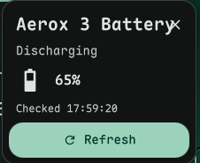

# DMS Aerox 3 Battery Widget

DankMaterialShell (DMS) widget that shows the battery level of a
SteelSeries Aerox 3 Wireless Gen 2 mouse in the bar, styled to match DMS's
own laptop-battery widget (same icon set and color rules). Built for my
personal desktop setup. Verified working over both the 2.4GHz wireless dongle (USB PID `1038:1890`) and a direct USB
cable (`1038:1892`).



Existing capture from my DMS desktop; battery level and appearance vary with
your mouse and theme. See [screenshot notes](screenshots/README.md).

## Compatibility

- Requires a running [DankMaterialShell](https://github.com/AvengeMedia/DankMaterialShell)
  desktop, Python 3, `hidapi`, and Linux udev permissions.
- Verified with the Gen 2 USB dongle and cable listed above. Other Aerox
  models are not supported by this widget's documented setup.
- Bluetooth is not supported by the bundled rivalcfg device profiles and
  has not been tested here.
- No minimum DMS version or wider distro compatibility matrix has been
  established.

## Features

- **Left click**: open a popout with the level, charging state, and a
  refresh button
- **Right click**: refresh immediately
- Polls every 2 minutes otherwise
- Sends a desktop notification (`dms notify`) the first time the level
  drops to 20%, 15%, 10%, and 5% each discharge cycle. Resets once charging
  starts or the level recovers above 20%, same style as DMS's own
  first-party `DankBatteryAlerts` plugin.
- Shows a distinct "Fully Charged" state (bar icon and popout) once the
  mouse is plugged in and at 95%+, instead of just "Charging".
- If a dependency below is missing, the bar icon switches to a distinct
  puzzle-piece icon (instead of looking like the mouse is just off) and the
  popout tells you what to install.

### Bar display settings

Configurable from *DMS Settings → Plugins → Aerox 3 Battery*:

- **Show Percentage** (off by default): adds a `NN%` text next to the bar
  icon.
- **Show Battery-State Colors** (on by default): colors the icon by battery
  state (low/charging/fully charged) instead of always neutral. The
  missing-dependency warning color is unaffected by this setting either
  way — it signals a setup problem, not a battery reading.
- **Show Charging Indicator** (on by default): shows a small bolt glyph
  next to the icon while charging. The icon's own shape always reflects
  charging state regardless of this setting — it only controls the extra
  glyph.

## How it reads the battery

This mouse's USB PIDs aren't recognized by any released version of
[rivalcfg](https://github.com/flozz/rivalcfg) (the tool that actually talks
to the mouse over HID) — support exists only on an unmerged branch, which
also needed a small core fix beyond just adding the device. Rather than
requiring you to find, clone, and patch that branch yourself, this plugin
**vendors a pinned copy of it** in `vendor/rivalcfg/` — see
[`vendor/NOTICE.md`](vendor/NOTICE.md) for exactly what's vendored, why, and
how to re-sync it if the upstream PR ever merges. You do not need to install
or clone rivalcfg separately.

## Requirements

Two things *can't* be vendored and need a one-time setup step: the `hid`
Python module (PyPI package `hidapi` — a compiled C extension, so unlike
rivalcfg it can't ship as plain source in this repo) and a udev rule
granting unprivileged `hidraw` access to the mouse.

**Run the setup script** — it checks both, skips anything already done, and
finishes with a live check against the actual mouse:

Run it **after cloning**, from the plugin directory:

```bash
cd ~/.config/DankMaterialShell/plugins/aerox3Battery
bash ./setup.sh
```

It's safe to re-run any time (e.g. after moving the mouse to a new machine).
If the widget's bar icon shows a puzzle piece instead of a battery, open the
popout for dependency details. The current **Copy Setup Command** helper
uses `sh`, but the setup wizard requires Bash; use `bash ./setup.sh` from
the plugin directory as shown above. The wizard may request sudo to install
udev rules, which grant all local users access to these device IDs.

<details>
<summary>Or do it by hand</summary>

**1. Install hidapi:**

```bash
pip install --user hidapi
```

**2. Add a udev rule** granting access to both PIDs. Create
`/etc/udev/rules.d/99-steelseries-aerox3-gen2.rules`:

```
SUBSYSTEM=="hidraw", ATTRS{idVendor}=="1038", ATTRS{idProduct}=="1890", MODE="0666"
SUBSYSTEM=="usb",    ATTRS{idVendor}=="1038", ATTRS{idProduct}=="1890", MODE="0666"
SUBSYSTEM=="hidraw", ATTRS{idVendor}=="1038", ATTRS{idProduct}=="1892", MODE="0666"
SUBSYSTEM=="usb",    ATTRS{idVendor}=="1038", ATTRS{idProduct}=="1892", MODE="0666"
```

Then reload udev and reconnect the mouse:

```bash
sudo udevadm control --reload-rules
sudo udevadm trigger
```

> [!TIP]
> If you already use rivalcfg for other SteelSeries gear and have run
> `rivalcfg --update-udev` before, you likely already have a rule covering
> these PIDs and can skip this — `setup.sh` detects that automatically too.

</details>

## Install

Clone directly into the plugins directory (the commands below do not depend
on registry acceptance):

```bash
mkdir -p ~/.config/DankMaterialShell/plugins
git clone https://github.com/Crambeary/dms-aerox3-battery-widget \
  ~/.config/DankMaterialShell/plugins/aerox3Battery
dms restart
```

Run the [one-time setup](#requirements), then enable **Aerox 3 Battery**
in *DMS Settings → Plugins* and add its widget from *DMS Settings → Dank Bar → Widgets*.

## Troubleshooting

From the plugin directory, run the same read-only query the widget uses:

```bash
./scripts/battery-level.sh
```

A successful read prints `Charging [...]` or `Discharging [...]`. For a
missing `hidapi` module, rerun setup with Bash. If no supported device is
found, check the dongle/cable, mouse power, and udev permissions; reconnect
the device after changing rules. Right click the widget to refresh.

## Development

If you're editing this plugin, clone it wherever you keep code and symlink
it into place instead, so edits don't require re-cloning:

```bash
git clone https://github.com/Crambeary/dms-aerox3-battery-widget ~/dev/dms-aerox3-battery-widget
ln -s ~/dev/dms-aerox3-battery-widget ~/.config/DankMaterialShell/plugins/aerox3Battery
```

DMS plugins are not hot-reloaded automatically. After editing
`Aerox3Battery.qml`, run:

```bash
dms ipc call plugins reload aerox3Battery
```

## Credits

- [flozz/rivalcfg](https://github.com/flozz/rivalcfg) does all the actual
  work of talking to the mouse over HID — this widget is a thin bar UI
  wrapped around it. Aerox 3 Wireless Gen 2 support and the battery-reading
  fix it depends on come from the unmerged `device_aerox3_wireless_gen2`
  branch; see [`vendor/NOTICE.md`](vendor/NOTICE.md) for the pinned commit
  and exact diff.
- [AvengeMedia/DankMaterialShell](https://github.com/AvengeMedia/DankMaterialShell)
  for the shell, plugin API, and the `Theme.getBatteryIcon()` icon set this
  widget reuses.
- The cascading low-battery notification design follows DMS's own
  first-party `DankBatteryAlerts` plugin.
